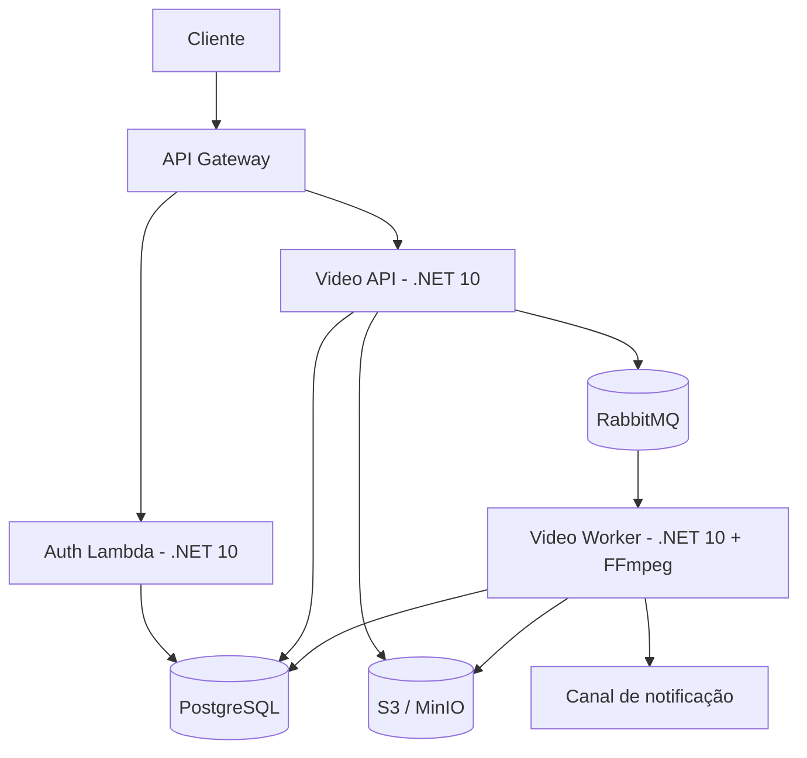
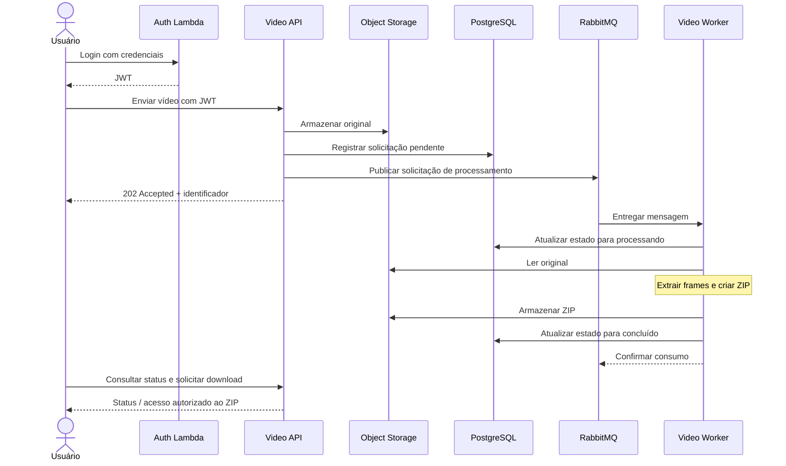

# FrameFlow — Documento de Arquitetura de Software

**Projeto:** Sistema de Processamento de Vídeos — Hackathon FIAP X  
**Versão:** 1.0 — Arquitetura proposta  
**Status:** Proposta técnica; implantação e validação pendentes

## 1. Visão geral

O FrameFlow é uma solução distribuída para receber vídeos de usuários autenticados, extrair imagens de seus frames e disponibilizar o resultado em arquivos ZIP. A arquitetura separa a interface HTTP do processamento intensivo, permitindo execução concorrente, escalabilidade independente e recuperação de falhas.

## 2. Requisitos arquiteturalmente relevantes

| Requisito | Abordagem proposta |
|---|---|
| Processamento simultâneo | Workers concorrentes com controle de paralelismo |
| Absorção de picos sem perda de solicitações | Persistência da solicitação, fila durável, confirmações e recuperação de falhas |
| Acesso por usuário e senha | Autenticação via Lambda, senhas com hash seguro e JWT |
| Acompanhamento por usuário | Persistência do estado e autorização por proprietário |
| Notificação em caso de erro | Notificação após falha definitiva |
| Persistência | PostgreSQL para metadados; object storage para arquivos |
| Escalabilidade | Contêineres e escalonamento de API e workers no Kubernetes |
| Qualidade e entrega | Testes automatizados, GitHub Actions e documentação operacional |

## 3. Visão de componentes

**Auth Lambda:** valida credenciais e emite JWT.  
**Video API:** valida JWT, recebe upload, registra solicitações, consulta status e autoriza download.  
**Video Worker:** consome solicitações, executa FFmpeg, gera ZIP, persiste resultados e trata erros.  
**RabbitMQ:** desacopla o recebimento do processamento.  
**PostgreSQL:** mantém usuários e metadados dos processamentos; limites de propriedade dos dados serão detalhados.  
**S3/MinIO:** armazena arquivos originais e ZIPs, sem transportar binários nas mensagens.

## 4. Fluxo de processamento

A publicação deverá ser confiável mesmo diante de falhas entre banco e broker; o padrão Transactional Outbox é a abordagem candidata. O diagrama representa o fluxo pretendido, não uma implementação já validada.

## 5. Modelo de domínio

**Usuário:** identificador, nome, e-mail único, hash de senha e data de criação.  
**Processamento de vídeo:** identificador, identificador do usuário, nome original, chave do vídeo, chave do ZIP (opcional), estado, tentativas, erro (opcional), datas de criação, início e término.

Estados principais: `PENDENTE`, `PROCESSANDO`, `CONCLUIDO`, `FALHOU`. Falhas transitórias poderão gerar novas tentativas antes da transição definitiva para `FALHOU`. As transições devem ser idempotentes e seguras diante de consumidores concorrentes.

## 6. Interfaces e integração

| Método | Endpoint proposto | Responsabilidade |
|---|---|---|
| POST | `/auth/register` | Cadastrar usuário |
| POST | `/auth/login` | Autenticar e emitir JWT |
| POST | `/videos` | Enviar vídeo e iniciar processamento |
| GET | `/videos` | Listar vídeos do usuário autenticado |
| GET | `/videos/{id}` | Consultar processamento autorizado |
| GET | `/videos/{id}/download` | Disponibilizar ZIP concluído |

**Evento proposto:** `VideoProcessingRequested`, versão 1, contendo `eventId`, `videoId`, `userId`, `storageKey` e `occurredAt`. O arquivo de vídeo não trafega pelo RabbitMQ. Os contratos definitivos serão publicados com a implementação e descritos em OpenAPI quando aplicável.

## 7. Segurança e confiabilidade

A solução deverá armazenar senhas com hash apropriado, validar assinatura, emissor, audiência e expiração do JWT e restringir consultas e downloads ao proprietário. Os arquivos permanecerão privados, com acesso mediado pela API ou URLs assinadas temporárias. Uploads terão validação de formato e limites de tamanho.

Para confiabilidade, serão adotadas filas duráveis, mensagens persistentes, confirmação de publicação, ACK após persistência, idempotência, política de novas tentativas e dead-letter queue. Workers terão limites de CPU, memória, disco temporário e concorrência. O RabbitMQ implantado no Kubernetes exigirá persistência e procedimento de recuperação.

## 8. Implantação e portabilidade

A implantação-alvo utiliza AWS API Gateway e Lambda para autenticação, Kubernetes/EKS para Video API e Worker, RabbitMQ, PostgreSQL e armazenamento de objetos. O ambiente local utilizará Docker Compose e MinIO como alternativa ao S3. A disponibilidade de serviços AWS depende das permissões do laboratório.

As integrações com armazenamento e mensageria serão encapsuladas em adapters, reduzindo dependência de SDKs na lógica de negócio. A portabilidade entre nuvens ainda requer adaptações de infraestrutura, rede e identidade.

## 9. Qualidade e observabilidade

Serão previstos testes unitários de domínio e aplicação, testes de integração com banco e broker, testes do fluxo ponta a ponta e cenários de concorrência e falhas. A entrega automatizada utilizará GitHub Actions, build de imagens e manifests Kubernetes. Logs estruturados correlacionados por identificadores de vídeo e evento, métricas, health checks e rastreabilidade de erros apoiarão a operação.

## 10. Organização do código e infraestrutura

- `frameflow-auth`: autenticação serverless e testes.
- `frameflow-video-api`: API HTTP, regras de aplicação e testes.
- `frameflow-video-worker`: consumidor, processamento e testes.
- `frameflow-infra`: diagramas, infraestrutura como código, manifests e orientações de implantação.

## 11. Decisões e pontos de validação

**Decisões adotadas:** .NET 10, serviços independentes, autenticação Lambda, RabbitMQ, PostgreSQL, FFmpeg, Kubernetes, GitHub Actions e estratégia S3/MinIO.

**Pontos ainda sujeitos a validação:** permissões AWS; topologia de banco e broker; mecanismo definitivo de publicação confiável; canal de notificações; políticas de retenção; limites de upload; estratégia de escalonamento; configuração de deploy e testes de carga. Estes itens deverão ser atualizados com evidências antes da entrega final.
